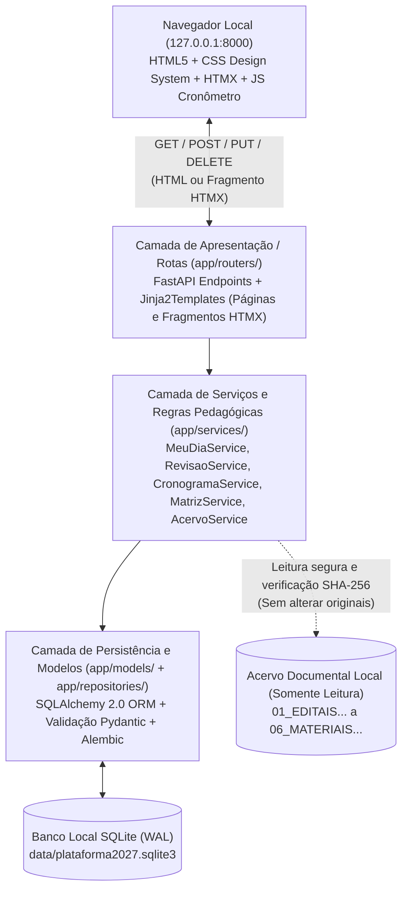
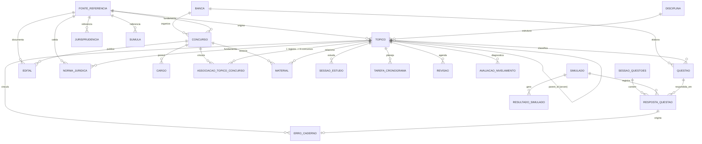

# ARQUITETURA TÉCNICA DETALHADA — PLATAFORMA CONCURSO 2027 (FASE 2)

**Data de elaboração:** 23/11/2026  
**Raiz oficial do projeto:** `C:\Users\nadja\OneDrive\Documents\2027 PLATAFORMA`  
**Fase do Plano de Execução:** Fase 2 — Arquitetura técnica detalhada  
**Complemento à:** `ESPECIFICACAO_COMPLETA_PLATAFORMA_2027.md` e `PLANO_DE_EXECUCAO_CODEX_2027.md`  
**Estado de execução:** Documento arquitetural (nenhum pacote instalado e nenhum código-fonte implementado nesta fase).

---

## 1. Avaliação de Viabilidade Tecnológica e Ajustes Técnicos Recomendados

### 1.1 Stack Definida pela Usuária
- **Linguagem:** Python 3.13 (`Python 3.13.5` já instalado localmente em `C:\Users\nadja\AppData\Local\Programs\Python\Python313\python.exe`).
- **Backend Web:** FastAPI.
- **Banco de Dados Local:** SQLite (`sqlite3` versão `3.49.1` nativo no Python 3.13.5).
- **ORM / Camada de Dados:** SQLAlchemy 2.0+ (estilo declarativo moderno `Mapped` / `mapped_column`).
- **Migrações de Esquema:** Alembic.
- **Frontend / Interface:** HTML5 semântico, CSS3 moderno (variáveis CSS / Design System próprio) e JavaScript (Vanilla ES6+).
- **Interatividade Declarativa:** HTMX.

### 1.2 Parecer de Viabilidade Técnica
A combinação escolhida é **plenamente viável, madura e tecnicamente ideal** para os requisitos da Plataforma Concurso 2027:
1. **Execução 100% Local e Offline no Windows:** Ao contrário de arquiteturas SPA complexas que exigem dois servidores em paralelo ou serviços em nuvem, um único processo Python (`uvicorn`) serve tanto as páginas HTML renderizadas via `Jinja2` quanto os fragmentos dinâmicos `HTMX` e os arquivos estáticos locais.
2. **Adequação do HTMX:** Permite atualização parcial de componentes (concluir revisão no *Meu Dia*, filtrar a *Matriz Integrada*, registrar questão, expandir árvore de assuntos, abrir modal de *Caderno de Erros*) diretamente com respostas HTML do FastAPI, mantendo o estado concentrado no backend Python/SQLite e reduzindo drasticamente código JavaScript boilerplate.
3. **Zero Custo e Alta Durabilidade:** SQLite em arquivo único com SQLAlchemy + Alembic oferece integridade relacional estrita, histórico de migrações auditável e backup trivial por cópia atômica.

### 1.3 Ajustes Técnicos e Complementos Necessários (Justificados)

Para que a stack funcione com máxima confiabilidade, segurança e operação 100% offline no Windows, propõem-se os seguintes ajustes técnicos complementares:

1. **Empacotamento Local (Vendoring) do HTMX e Ativos Visuais (Requisito Offline):**
   - **Problema potencial:** Se o HTMX ou fontes tipográficas forem carregados via CDN (`unpkg.com`, `jsdelivr`, `Google Fonts`), a aplicação falhará ou perderá formatação quando o computador estiver sem internet.
   - **Ajuste:** O arquivo `htmx.min.js` (v2.x), ícones SVG e fontes serão armazenados localmente dentro de `app/static/vendor/`. Nenhuma página fará requisições a domínios externos.
2. **Configuração Obrigatória de Pragmas no SQLite (`WAL` + `Foreign Keys`):**
   - **Problema potencial:** Por padrão, o driver SQLite não ativa a verificação de chaves estrangeiras (`PRAGMA foreign_keys = OFF`) em cada nova conexão e utiliza journal padrão que pode gerar `database is locked` em requisições HTMX simultâneas.
   - **Ajuste:** Registrar um listener `connect` no `Engine` do SQLAlchemy para executar automaticamente em toda conexão:
     - `PRAGMA foreign_keys = ON;` (garante integridade referencial real entre as 24 entidades).
     - `PRAGMA journal_mode = WAL;` (Write-Ahead Logging: leituras não bloqueiam escritas).
     - `PRAGMA synchronous = NORMAL;` e `PRAGMA busy_timeout = 5000;`.
3. **Modo Batch (`render_as_batch=True`) no Alembic:**
   - **Problema potencial:** O SQLite possui suporte nativo limitado ao comando `ALTER TABLE` (não altera nem remove restrições `FOREIGN KEY` ou `NOT NULL` diretamente).
   - **Ajuste:** Configurar `render_as_batch=True` no `migrations/env.py` do Alembic, permitindo migrações seguras de colunas e chaves no SQLite via estratégia de *batch table recreation*.
4. **Uso de JavaScript Vanilla Restrito a Interações Client-Side Instantâneas:**
   - **Ajuste:** O HTMX cuidará de ~90% da interatividade (CRUD, filtros, paginação, abas, modais). O JavaScript puro (`app/static/js/`) será usado de forma complementar apenas para:
     - Cronômetro local de Sessão de Estudo e Simulados (com sincronização periódica e salvamento final no backend).
     - Recolhimento/expansão instantânea do menu lateral com persistência de estado e atalhos de teclado/acessibilidade (`Esc` para fechar modal, gerenciamento de foco ARIA).
5. **Isolamento em Ambiente Virtual Local (`.venv`):**
   - **Diagnóstico atual:** A inspeção do `pip list` no Python 3.13.5 mostrou que `Jinja2 (3.1.6)`, `anyio (4.9.0)`, `httpx (0.28.1)` e `h11 (0.16.0)` já estão no Python global, mas `fastapi`, `uvicorn`, `sqlalchemy`, `alembic`, `python-multipart` e `pytest` não estão instalados.
   - **Ajuste:** Na fase de implementação autorizada, criar um ambiente virtual `.venv` na raiz do projeto (ignorado pelo Git) para instalar as dependências com versões fixadas (`requirements.txt`), sem poluir o Python global da máquina.

---

## 2. Separação Estrutural em 5 Domínios e Preparação para GitHub Privado

A arquitetura organiza o diretório raiz `C:\Users\nadja\OneDrive\Documents\2027 PLATAFORMA` em **5 domínios estritamente separados**, garantindo que o acervo documental permaneça intocado e que o repositório GitHub privado receba **exclusivamente código-fonte e documentação técnica**.

### 2.1 Mapa dos 5 Domínios na Raiz Oficial

```text
C:\Users\nadja\OneDrive\Documents\2027 PLATAFORMA\
│
├── [DOMÍNIO 1: CÓDIGO-FONTE E CONFIGURAÇÃO VERSIONÁVEL (Vai para o GitHub Privado)]
│   ├── app/                          # Aplicação Python/FastAPI
│   │   ├── __init__.py
│   │   ├── main.py                   # Entrypoint FastAPI, montagem de rotas e static
│   │   ├── config.py                 # Configurações locais via variáveis de ambiente / defaults
│   │   ├── database.py               # Engine SQLAlchemy, SessionLocal e listener PRAGMAs SQLite
│   │   ├── models/                   # Modelos SQLAlchemy (as 24 entidades do sistema)
│   │   ├── schemas/                  # Schemas Pydantic de validação de entrada/saída
│   │   ├── repositories/             # Consultas encapsuladas e acesso a dados
│   │   ├── services/                 # Regras de negócio e motores pedagógicos (Meu Dia, Revisões, Matriz, Acervo)
│   │   ├── routers/                  # Rotas FastAPI (páginas completas + fragmentos HTMX)
│   │   ├── templates/                # Templates HTML Jinja2 (layouts, páginas dos 17 módulos, parciais HTMX)
│   │   └── static/                   # CSS do Design System, JS complementar, ícones SVG e htmx.min.js local
│   ├── migrations/                   # Migrações versionadas do Alembic (env.py + versions/)
│   ├── tests/                        # Suíte de testes automatizados Pytest (unidade, integração, persistência)
│   ├── scripts/                      # Scripts utilitários (run_local.bat/.py, backup_db.py, sync_acervo.py)
│   ├── alembic.ini                   # Configuração do Alembic
│   ├── requirements.txt              # Dependências Python com versões fixadas
│   ├── .env.example                  # Exemplo documentado de variáveis de ambiente (sem segredos)
│   └── .gitignore                    # Bloqueio rigoroso de PDFs, acervo, banco SQLite, backups e dados pessoais
│
├── [DOMÍNIO 2: DOCUMENTAÇÃO TÉCNICA E ESPECIFICAÇÃO (Versionável)]
│   ├── ESPECIFICACAO_COMPLETA_PLATAFORMA_2027.md
│   ├── PLANO_DE_EXECUCAO_CODEX_2027.md
│   ├── PROMPT_1_DOCUMENTACAO_MESTRE_CODEX.md
│   ├── PROMPT_2_DESENVOLVIMENTO_CODEX.md
│   └── docs/                         # Documentação técnica versionável (Design System, Fórmulas, Manual de Backup)
│
├── [DOMÍNIO 3: ACERVO DOCUMENTAL ORIGINAL — SOMENTE LEITURA / IGNORADO PELO GIT]
│   ├── 01_EDITAIS_E_PLANEJAMENTO/    # (Intocado — 8 arquivos)
│   ├── 02_SEFAZ_PE/                  # (Intocado — 12 arquivos)
│   ├── 03_ANPD/                      # (Intocado — 65 arquivos)
│   ├── 04_DISCIPLINAS_E_LEGISLACAO/  # (Intocado — 44 arquivos)
│   ├── 05_PROVAS_E_GABARITOS/        # (Intocado — 56 arquivos)
│   └── 06_MATERIAIS_E_INVENTARIO/    # (Intocado — inventários, PDFs e relatórios de diagnóstico/arquitetura)
│
├── [DOMÍNIO 4: BANCO DE DADOS E DADOS DE UTILIZAÇÃO — IGNORADO PELO GIT]
│   └── data/
│       ├── plataforma2027.sqlite3    # Banco SQLite principal (+ arquivos -wal e -shm em execução)
│       ├── exports/                  # Relatórios exportados pela usuária (CSV/JSON/MD)
│       └── logs/                     # Logs locais rotativos de execução e auditoria de erros
│
└── [DOMÍNIO 5: BACKUPS LOCAIS — IGNORADO PELO GIT]
    └── backups/
        └── YYYYMMDD_HHMMSS_backup.sqlite3  # Snapshots atômicos do banco + manifesto SHA-256
```

### 2.2 Política Rigorosa de `.gitignore` (Proteção de Dados Pessoais e Acervo)

O arquivo `.gitignore` será configurado com **bloqueio duplo** (por diretório do acervo/dados e por extensão documental/binária em qualquer caminho), garantindo que nenhum PDF, norma HTML do acervo, planilha de inventário, banco SQLite, backup ou variável de ambiente seja enviado ao GitHub:

```gitignore
# =====================================================================
# 1. ACERVO DOCUMENTAL ORIGINAL (6 PASTAS OFICIAIS — NUNCA ENVIAR)
# =====================================================================
/01_EDITAIS_E_PLANEJAMENTO/
/02_SEFAZ_PE/
/03_ANPD/
/04_DISCIPLINAS_E_LEGISLACAO/
/05_PROVAS_E_GABARITOS/
/06_MATERIAIS_E_INVENTARIO/*

# Exceção opcional apenas para os documentos técnicos de engenharia gerados nas Fases 1 e 2:
!/06_MATERIAIS_E_INVENTARIO/DIAGNOSTICO_TECNICO_PLATAFORMA_2027.md
!/06_MATERIAIS_E_INVENTARIO/ARQUITETURA_TECNICA_PLATAFORMA_2027.md

# =====================================================================
# 2. BLOQUEIO POR EXTENSÃO DOCUMENTAL E DE DADOS EM QUALQUER PASTA
# =====================================================================
*.pdf
*.PDF
*.xlsx
*.xls
*.csv
*.ndjson
*.docx
*.doc

# =====================================================================
# 3. BANCO DE DADOS SQLITE E DADOS DE UTILIZAÇÃO PESSOAL
# =====================================================================
/data/
*.sqlite
*.sqlite3
*.db
*.db-journal
*.db-wal
*.db-shm
*.sqlite3-wal
*.sqlite3-shm

# =====================================================================
# 4. BACKUPS E EXPORTAÇÕES
# =====================================================================
/backups/
*.bak
*.zip
*.tar.gz

# =====================================================================
# 5. CREDENCIAIS, AMBIENTE VIRTUAL PYTHON E LOGS
# =====================================================================
.env
.env.*
!.env.example
.venv/
venv/
ENV/
__pycache__/
*.py[cod]
*$py.class
.pytest_cache/
*.log
/logs/

# =====================================================================
# 6. ARQUIVOS DE SISTEMA OPERACIONAL E EDITORES
# =====================================================================
Thumbs.db
Desktop.ini
.DS_Store
```

---

## 3. Arquitetura Modular da Aplicação (Backend FastAPI + Frontend Jinja2/HTMX)

### 3.1 Padrão Arquitetural em Camadas
A aplicação seguirá uma arquitetura limpa em 4 camadas dentro de `app/`:



### 3.2 Mapa de Módulos e Rotas (17 Módulos do Menu Principal)

Cada um dos 17 itens do menu principal (`ESPECIFICACAO_COMPLETA_PLATAFORMA_2027.md`, seção 3.3) terá uma rota principal dedicada e rotas parciais HTMX (`/hx/...`) para operações sem recarregamento completo de página. Módulos ainda não implementados em determinada fase exibirão o **Estado Pendente Padronizado** (nunca dados falsos ou botões simulados):

| # | Módulo do Menu | Rota Principal | Router FastAPI (`app/routers/`) | Service Principal (`app/services/`) | Fase de Implementação Funcional |
|---:|---|---|---|---|---|
| 1 | **Meu Dia** *(Página Inicial)* | `GET /` e `GET /meu-dia` | `meu_dia.py` | `meu_dia_service.py` | Estrutura: Fase 4 / Funcional: Fase 8 |
| 2 | **Cronograma** | `GET /cronograma` | `cronograma.py` | `cronograma_service.py` | Estrutura: Fase 4 / Funcional: Fase 8 |
| 3 | **Disciplinas** | `GET /disciplinas` | `disciplinas.py` | `disciplina_service.py` | Estrutura: Fase 4 / Funcional: Fases 6–7 |
| 4 | **Conteúdos (Matriz Integrada)** | `GET /conteudos` | `conteudos.py` | `matriz_service.py` | Estrutura: Fase 4 / Funcional: Fases 6–7 |
| 5 | **Revisões** | `GET /revisoes` | `revisoes.py` | `revisao_service.py` | Estrutura: Fase 4 / Funcional: Fase 8 |
| 6 | **Questões** | `GET /questoes` | `questoes.py` | `questao_service.py` | Estrutura: Fase 4 / Funcional: Fase 9 |
| 7 | **Caderno de Erros** | `GET /caderno-erros` | `caderno_erros.py` | `erro_service.py` | Estrutura: Fase 4 / Funcional: Fase 9 |
| 8 | **Simulados** | `GET /simulados` | `simulados.py` | `simulado_service.py` | Estrutura: Fase 4 / Funcional: Fase 9 |
| 9 | **Desempenho** | `GET /desempenho` | `desempenho.py` | `desempenho_service.py` | Estrutura: Fase 4 / Funcional: Fase 10 |
| 10 | **Jurisprudência** | `GET /jurisprudencia` | `jurisprudencia.py` | `jurisprudencia_service.py` | Estrutura: Fase 4 / Funcional: Fase 11 |
| 11 | **Súmulas** | `GET /sumulas` | `sumulas.py` | `sumula_service.py` | Estrutura: Fase 4 / Funcional: Fase 11 |
| 12 | **Editais e PDFs** | `GET /editais` | `editais.py` | `concurso_service.py` | Estrutura: Fase 4 / Funcional: Fase 6 |
| 13 | **Banco de Conteúdos** | `GET /banco-conteudos` | `banco_conteudos.py` | `acervo_service.py` | Estrutura: Fase 4 / Funcional: Fase 7 |
| 14 | **Nivelamento** | `GET /nivelamento` | `nivelamento.py` | `nivelamento_service.py` | Estrutura: Fase 4 / Funcional: Fase 11 |
| 15 | **Radar** | `GET /radar` | `radar.py` | `radar_service.py` | Estrutura: Fase 4 / Funcional: Fase 11 |
| 16 | **Relatórios** | `GET /relatorios` | `relatorios.py` | `relatorio_service.py` | Estrutura: Fase 4 / Funcional: Fase 10 |
| 17 | **Configurações** | `GET /configuracoes` | `configuracoes.py` | `config_service.py` + `backup_service.py` | Estrutura: Fase 4 / Funcional: Fases 5, 8 e 12 |

---

## 4. Modelo de Dados Relacional Completo (24 Entidades + Auditoria)

O modelo de dados contempla integralmente as **24 entidades mínimas** exigidas na Seção 5 da Especificação, além de uma tabela de **Trilha de Auditoria (`auditoria_alteracao`)** exigida nos itens 4.3 e 4.6 para rastrear alterações na Matriz Integrada e na Legislação.

### 4.1 Diagrama Entidade-Relacionamento (Núcleo Integrado)



### 4.2 Especificação das 24 Entidades (Tabelas SQLite / Modelos SQLAlchemy)

Todas as tabelas possuirão chave primária inteira autoincremental (`id INTEGER PRIMARY KEY AUTOINCREMENT`), carimbos `criado_em` (`DATETIME NOT NULL DEFAULT CURRENT_TIMESTAMP`) e `atualizado_em` (`DATETIME NOT NULL`).

#### Bloco A — Referências, Concursos e Editais
1. **`fonte_referencia` (Fonte/referência)**
   - **Finalidade:** Rastrear a origem oficial de editais, tópicos, normas, questões, jurisprudência e radar.
   - **Campos principais:** `id`, `tipo_fonte` (`OFICIAL_PUBLICADO`, `TERMO_REFERENCIA`, `HISTORICO`, `PORTAL_LEGISLACAO`, `TRIBUNAL`, `ELABORADO_PLATAFORMA`, `EXTERNA_QCONCURSOS`), `titulo`, `orgao_emissor`, `url`, `caminho_arquivo_local`, `data_publicacao`, `data_ultima_consulta`, `observacoes`.
2. **`banca` (Banca)**
   - **Finalidade:** Cadastro de bancas organizadoras (ex.: `Cebraspe`, `IAUPE/UPENET`, `FGV`, `Cesgranrio`).
   - **Campos principais:** `id`, `sigla` (`UNIQUE NOT NULL`), `nome_completo`, `estilo_predominante` (`CERTO_ERRADO`, `MULTIPLA_ESCOLHA`, `AMBOS`), `observacoes_perfil`.
3. **`concurso` (Concurso)**
   - **Finalidade:** Cadastro de concursos prioritários (SEFAZ-PE, ANPD) e acompanhados no Radar.
   - **Campos principais:** `id`, `codigo` (`UNIQUE NOT NULL`, ex.: `SEFAZ_PE_APOIO`, `ANPD_ESP_DADOS`), `orgao`, `sigla_orgao`, `esfera` (`FEDERAL`, `ESTADUAL`, `MUNICIPAL`), `banca_id` (`FK -> banca.id`), `status_concurso` (`OFICIAL_PUBLICADO`, `AUTORIZADO_ANUNCIADO`, `HISTORICO`, `PROJECCAO_EXPECTATIVA`), `prioridade_usuario` (`NUCLEO_PRIORITARIO`, `SECUNDARIO`, `RADAR`), `compatibilidade_percentual`, `data_prevista_edital`, `data_prevista_prova`, `fonte_id` (`FK -> fonte_referencia.id`), `data_ultima_consulta`, `observacoes`.
4. **`cargo` (Cargo)**
   - **Finalidade:** Especificar o cargo exato do concurso (evitando confusão entre Analista de Apoio Administrativo e Auditor Fiscal na SEFAZ-PE).
   - **Campos principais:** `id`, `concurso_id` (`FK -> concurso.id ON DELETE CASCADE`), `nome_cargo`, `area_especialidade`, `escolaridade`, `vagas_imediatas`, `cadastro_reserva`, `remuneracao_descricao`, `jornada_semanal`, `cargo_alvo_principal` (`BOOLEAN`).
5. **`edital` (Edital)**
   - **Finalidade:** Vincular documentos normativos de certames (Edital 001/2022 SEFAZ-PE, TR 111/2026 ANPD, etc.).
   - **Campos principais:** `id`, `concurso_id` (`FK -> concurso.id`), `cargo_id` (`FK -> cargo.id NULL`), `numero_ano`, `tipo_documento` (`EDITAL_ABERTURA`, `TERMO_REFERENCIA`, `AUTORIZACAO_BANCA`, `COMUNICADO`), `natureza_referencia` (`OFICIAL_VIGENTE`, `HISTORICO_REFERENCIA`, `PRELIMINAR_TR`), `data_publicacao`, `material_id` (`FK -> material.id NULL`), `fonte_id` (`FK -> fonte_referencia.id`), `observacoes`.

#### Bloco B — Matriz Integrada, Disciplinas, Materiais e Legislação
6. **`disciplina` (Disciplina)**
   - **Finalidade:** Catálogo único de disciplinas (ex.: *Direito Administrativo*, *Direito Constitucional*, *Administração Pública*, *AFO*, *LGPD e Proteção de Dados*, *Ciência de Dados e TI*, *Língua Portuguesa*, *Raciocínio Lógico*, *Legislação Estadual PE*).
   - **Campos principais:** `id`, `codigo` (`UNIQUE NOT NULL`), `nome` (`UNIQUE NOT NULL`), `area_tematica`, `eh_densa_legislacao` (`BOOLEAN NOT NULL DEFAULT 0` — aciona a regra pedagógica 2.2.3 de limitar a 1 disciplina nova no dia), `ordem_exibicao`, `descricao`.
7. **`topico` (Tópico — Matriz Integrada de Conteúdos)**
   - **Finalidade:** Base pedagógica única. Cada assunto/subassunto comum existe **uma única vez** nesta tabela.
   - **Campos principais:** `id`, `codigo_estavel` (`UNIQUE NOT NULL`, ex.: `DIR_ADM_LICIT_14133`), `disciplina_id` (`FK -> disciplina.id`), `topico_pai_id` (`FK -> topico.id NULL` — suporta árvore Assunto → Subassunto → Item), `nivel_granularidade` (`ASSUNTO`, `SUBASSUNTO`, `TOPICO_ESPECIFICO`), `titulo`, `descricao_objetiva`, `eh_denso` (`BOOLEAN DEFAULT 0`), `estimativa_esforco_minutos` (identificada explicitamente como estimativa), `prerequisitos_ids_json` (lista validada de IDs de tópicos pré-requisito), `status_estudo` (`NAO_INICIADO`, `EM_ESTUDO`, `ESTUDADO_PRIMEIRA_VEZ`, `EM_REVISAO`, `CONSOLIDADO`), `situacao_dominio` (`NAO_AVALIADO`, `INICIAL`, `EM_DESENVOLVIMENTO`, `BOM`, `CONSOLIDADO`), `origem_documental`, `fonte_id` (`FK -> fonte_referencia.id NULL`), `validado_na_matriz` (`BOOLEAN DEFAULT 0`).
   - **Restrição de unicidade anti-duplicação:** `UNIQUE(disciplina_id, topico_pai_id, titulo)`.
8. **`associacao_topico_concurso` (Associação tópico-concurso)**
   - **Finalidade:** Associar um único tópico da matriz a múltiplos concursos/editais com seus respectivos status e referências de página/item.
   - **Campos principais:** `id`, `topico_id` (`FK -> topico.id ON DELETE CASCADE`), `concurso_id` (`FK -> concurso.id ON DELETE CASCADE`), `cargo_id` (`FK -> cargo.id NULL`), `edital_id` (`FK -> edital.id NULL`), `status_no_concurso` (`CONFIRMADO_EDITAL`, `HISTORICO_REFERENCIA`, `COMPLEMENTAR`, `PENDENTE_CONFIRMACAO`), `item_edital_referencia` (página/artigo/item do edital), `peso_prioridade` (`NUMERIC` NULL), `fundamento_peso` (texto explicando a origem do peso, quando houver).
   - **Chave única composta:** `UNIQUE(topico_id, concurso_id, cargo_id)`.
9. **`material` (Material — Banco de Conteúdos)**
   - **Finalidade:** Catalogar os arquivos existentes nas 6 pastas oficiais sem movê-los ou duplicá-los.
   - **Campos principais:** `id`, `nome_arquivo`, `caminho_relativo` (`UNIQUE NOT NULL`, relativo à raiz oficial), `pasta_acervo` (`01_EDITAIS_E_PLANEJAMENTO`..`06_MATERIAIS_E_INVENTARIO`), `extensao`, `formato_real_verificado` (`PDF_VALIDO`, `HTML_VALIDO`, `HTML_SPA_INCOMPLETO`, `CSV`, `XLSX`, `MD`, `INVALIDO`), `tamanho_bytes`, `hash_sha256`, `data_modificacao_disco`, `titulo_catalogo`, `classificacao_utilidade` (`APROVADO_ESTUDO`, `REFERENCIA_COMPLEMENTAR`, `PAGINA_CONSULTA`, `DOWNLOAD_FALHOU`, `ARQUIVO_INVALIDO`, `IRRELEVANTE`, `DUPLICADO`), `tipo_material` (`EDITAL`, `LEGISLACAO`, `GUIA_MANUAL`, `PROVA_OBJETIVA`, `PROVA_DISCURSIVA`, `GABARITO`, `RELATORIO_INVENTARIO`), `disciplina_id` (`FK -> disciplina.id NULL`), `topico_id` (`FK -> topico.id NULL`), `concurso_id` (`FK -> concurso.id NULL`), `situacao_leitura` (`NAO_LIDO`, `EM_LEITURA`, `LIDO`, `VALIDADO`), `fonte_id` (`FK -> fonte_referencia.id NULL`), `alerta_auditoria`, `observacoes`.
10. **`norma_juridica` (Norma jurídica — Legislação)**
    - **Finalidade:** Controle detalhado de leis, decretos, constituições e resoluções da ANPD.
    - **Campos principais:** `id`, `tipo_norma` (`CONSTITUICAO`, `LEI_COMPLEMENTAR`, `LEI_ORDINARIA`, `DECRETO_LEI`, `DECRETO`, `RESOLUCAO_ANPD`, `ENUNCIADO_ANPD`, `NOTA_TECNICA`), `jurisdicao` (`FEDERAL`, `ESTADUAL_PE`), `numero`, `ano`, `ementa`, `fonte_oficial_url`, `data_atualizacao_verificada` (`DATE NULL` — nunca declarada atualizada sem conferência), `status_vigencia` (`VIGENTE_VERIFICADA`, `VIGENTE_PENDENTE_CONFERENCIA`, `PARCIALMENTE_REVOGADA`, `REVOGADA`), `dispositivos_relevantes`, `status_leitura` (`NAO_LIDA`, `EM_LEITURA`, `LIDA`, `GRIFADA_RESUMIDA`), `nivel_dominio` (`NAO_AVALIADO`, `INICIAL`, `EM_DESENVOLVIMENTO`, `BOM`, `CONSOLIDADO`), `disciplina_id` (`FK -> disciplina.id`), `topico_id` (`FK -> topico.id NULL`), `material_html_id` (`FK -> material.id NULL`), `material_pdf_id` (`FK -> material.id NULL`).

#### Bloco C — Rotina Diária (Meu Dia), Cronograma e Revisões Espaçadas
11. **`sessao_estudo` (Sessão de estudo)**
    - **Finalidade:** Registro real de tempo, dificuldade, confiança e observações de cada bloco de estudo executado.
    - **Campos principais:** `id`, `data_sessao` (`DATE NOT NULL`), `inicio_em` (`DATETIME`), `fim_em` (`DATETIME NULL`), `duracao_minutos` (`INTEGER NOT NULL`), `tipo_sessao` (`TEORIA`, `LEGISLACAO`, `REVISAO`, `QUESTOES`, `SIMULADO`), `status_execucao` (`EM_ANDAMENTO`, `CONCLUIDA`, `INTERROMPIDA`), `disciplina_id` (`FK -> disciplina.id`), `topico_id` (`FK -> topico.id NULL`), `material_id` (`FK -> material.id NULL`), `tarefa_cronograma_id` (`FK -> tarefa_cronograma.id NULL`), `revisao_id` (`FK -> revisao.id NULL`), `dificuldade_percebida` (`1..5 NULL`), `nivel_confianca` (`BAIXA`, `MEDIA`, `ALTA`), `observacoes`.
12. **`tarefa_cronograma` (Tarefa de cronograma)**
    - **Finalidade:** Item planejado para um dia específico no Meu Dia / Cronograma.
    - **Campos principais:** `id`, `data_programada` (`DATE NOT NULL`), `ordem_no_dia` (`INTEGER NOT NULL`), `tipo_tarefa` (`REVISAO`, `CONTEUDO_NOVO`, `QUESTOES`, `LEGISLACAO`), `disciplina_id` (`FK -> disciplina.id`), `topico_id` (`FK -> topico.id NULL`), `revisao_id` (`FK -> revisao.id NULL`), `duracao_planejada_minutos`, `duracao_realizada_minutos` (`DEFAULT 0`), `questoes_planejadas` (`INTEGER NULL`), `status_tarefa` (`PENDENTE`, `EM_EXECUCAO`, `CONCLUIDA`, `ADIADA`, `REPROGRAMADA`), `motivo_selecao_diaria` (explicação pedagógica clara exibida no Meu Dia e relação com SEFAZ-PE/ANPD), `justificativa_adiamento`, `data_reprogramada_para` (`DATE NULL`), `eh_cronograma_definitivo` (`BOOLEAN DEFAULT 0`).
13. **`revisao` (Revisão — Espaçada D1/D7/D15/D30/D60)**
    - **Finalidade:** Controle individual de cada ciclo de revisão espaçada (nunca concluída automaticamente).
    - **Campos principais:** `id`, `topico_id` (`FK -> topico.id`), `disciplina_id` (`FK -> disciplina.id`), `sessao_origem_id` (`FK -> sessao_estudo.id NULL`), `ciclo_revisao` (`D1`, `D7`, `D15`, `D30`, `D60`, `PERSONALIZADA`, `REINCIDENCIA_ERRO`), `intervalo_dias_aplicado` (`INTEGER NOT NULL`), `data_prevista` (`DATE NOT NULL`), `data_realizada` (`DATE NULL`), `status_revisao` (`PENDENTE`, `ATRASADA`, `CONCLUIDA`, `ADIADA`, `REPROGRAMADA`), `dificuldade_na_revisao` (`1..5 NULL`), `confianca_na_revisao` (`BAIXA`, `MEDIA`, `ALTA` NULL), `percentual_acerto_revisao` (`NUMERIC NULL`), `justificativa_adiamento`, `observacoes`.

#### Bloco D — Questões, Caderno de Erros e Simulados
14. **`questao` (Questão)**
    - **Finalidade:** Cadastro manual ou extraído de provas reais do acervo (com referência opcional ao link/código do Qconcursos, sem inventar questões).
    - **Campos principais:** `id`, `codigo_externo_qconcursos` (`VARCHAR NULL`), `url_referencia_externa` (`VARCHAR NULL`), `origem_questao` (`ACERVO_PROVA_OFICIAL`, `REGISTRO_MANUAL_QCONCURSOS`, `REGISTRO_MANUAL_OUTRA`), `banca_id` (`FK -> banca.id NULL`), `concurso_referencia`, `prova_cargo_referencia`, `ano` (`INTEGER NULL`), `disciplina_id` (`FK -> disciplina.id`), `topico_id` (`FK -> topico.id NULL`), `modalidade` (`CERTO_ERRADO`, `MULTIPLA_ESCOLHA`, `DISCURSIVA`), `enunciado` (`TEXT`), `alternativas_json` (`TEXT NULL`), `gabarito_oficial` (`VARCHAR NULL`), `comentario_justificativa` (`TEXT NULL`), `material_prova_id` (`FK -> material.id NULL`), `numero_na_prova` (`INTEGER NULL`), `fonte_id` (`FK -> fonte_referencia.id NULL`).
15. **`sessao_questoes` (Sessão de questões)**
    - **Finalidade:** Agrupar uma bateria de resolução de questões (inclusive baterias feitas diretamente no Qconcursos e registradas na plataforma).
    - **Campos principais:** `id`, `data_sessao` (`DATE NOT NULL`), `disciplina_id` (`FK -> disciplina.id`), `topico_id` (`FK -> topico.id NULL`), `banca_id` (`FK -> banca.id NULL`), `plataforma_utilizada` (`PLATAFORMA_LOCAL`, `QCONCURSOS`, `PROVA_PDF_ACERVO`), `url_filtro_qconcursos`, `total_respondidas`, `total_corretas`, `total_incorretas`, `total_em_branco`, `total_anuladas`, `tempo_total_segundos`, `observacoes`.
16. **`resposta_questao` (Resposta)**
    - **Finalidade:** Registro unitário da resolução de uma questão em uma sessão de estudo ou simulado.
    - **Campos principais:** `id`, `questao_id` (`FK -> questao.id NULL`), `sessao_questoes_id` (`FK -> sessao_questoes.id NULL`), `simulado_id` (`FK -> simulado.id NULL`), `disciplina_id` (`FK -> disciplina.id`), `topico_id` (`FK -> topico.id NULL`), `banca_id` (`FK -> banca.id NULL`), `data_resposta` (`DATETIME NOT NULL`), `resposta_marcada`, `resultado` (`CORRETA`, `INCORRETA`, `EM_BRANCO`, `ANULADA`), `confianca` (`SABIA`, `DUVIDA`, `CHUTE`), `tempo_gasto_segundos` (`INTEGER NULL`), `comentario_usuario`.
17. **`erro_caderno` (Erro — Caderno de Erros)**
    - **Finalidade:** Transformar questões erradas, dúvidas ou acertos por chute em ações estruturadas de revisão.
    - **Campos principais:** `id`, `resposta_questao_id` (`FK -> resposta_questao.id NULL`), `questao_id` (`FK -> questao.id NULL`), `disciplina_id` (`FK -> disciplina.id`), `topico_id` (`FK -> topico.id`), `banca_id` (`FK -> banca.id NULL`), `classificacao_erro` (`FALTA_CONHECIMENTO`, `INTERPRETACAO`, `DESATENCAO`, `CONFUSAO_CONCEITOS`, `ERRO_LEGISLACAO`, `CALCULO_RACIOCINIO`, `CHUTE_BAIXA_CONFIANCA`), `descricao_erro`, `correcao_fundamentada`, `plano_acao`, `quantidade_reincidencias` (`INTEGER NOT NULL DEFAULT 1`), `prioridade_revisao` (`NORMAL`, `ALTA`, `CRITICA`), `status_superacao` (`ATIVO`, `EM_REVISAO`, `SUPERADO`), `proxima_revisao_em` (`DATE NULL`).
18. **`simulado` (Simulado)**
    - **Finalidade:** Configuração e execução de simulados a partir do banco de questões reais disponíveis ou folha de respostas de prova PDF do acervo.
    - **Campos principais:** `id`, `titulo`, `concurso_alvo_id` (`FK -> concurso.id NULL`), `banca_id` (`FK -> banca.id NULL`), `material_prova_id` (`FK -> material.id NULL`), `data_criacao`, `data_aplicacao` (`DATETIME NULL`), `duracao_prevista_minutos`, `cronometro_ativo` (`BOOLEAN DEFAULT 1`), `quantidade_questoes`, `disciplinas_config_json`, `origem_itens_descricao` (obrigatório para indicar a origem real das questões), `status_simulado` (`RASCUNHO`, `EM_ANDAMENTO`, `FINALIZADO`).
19. **`resultado_simulado` (Resultado de simulado)**
    - **Finalidade:** Consolidação comparável do desempenho no simulado, com desdobramento por disciplina/assunto.
    - **Campos principais:** `id`, `simulado_id` (`FK -> simulado.id UNIQUE ON DELETE CASCADE`), `tempo_gasto_minutos`, `total_corretas`, `total_incorretas`, `total_em_branco`, `total_anuladas`, `total_chutes`, `pontuacao_liquida_cebraspe` (`NUMERIC NULL`), `percentual_bruto` (`NUMERIC`), `analise_por_disciplina_json`, `observacoes_pos_prova`.

#### Bloco E — Jurisprudência, Súmulas, Nivelamento, Desempenho e Configurações
20. **`jurisprudencia` (Jurisprudência)**
    - **Finalidade:** Cadastro de julgados e teses relevantes com fonte oficial verificável.
    - **Campos principais:** `id`, `tribunal_orgao` (`STF`, `STJ`, `TCU`, `ANPD_CD`, `TCE_PE`, `OUTRO`), `numero_processo_acordao`, `data_julgamento`, `tema`, `tese_ementa` (`TEXT NOT NULL`), `relevancia` (`BAIXA`, `MEDIA`, `ALTA`, `ESSENCIAL`), `disciplina_id` (`FK -> disciplina.id`), `topico_id` (`FK -> topico.id NULL`), `concurso_id` (`FK -> concurso.id NULL`), `lida` (`BOOLEAN DEFAULT 0`), `revisada` (`BOOLEAN DEFAULT 0`), `data_ultima_verificacao` (`DATE NOT NULL`), `fonte_url`, `fonte_id` (`FK -> fonte_referencia.id NULL`).
21. **`sumula` (Súmula)**
    - **Finalidade:** Cadastro de súmulas vinculantes, súmulas do STF/STJ/TCU e enunciados da ANPD.
    - **Campos principais:** `id`, `tribunal_orgao` (`STF_VINCULANTE`, `STF`, `STJ`, `TCU`, `ANPD`), `numero` (`INTEGER NOT NULL`), `enunciado_texto` (`TEXT NOT NULL`), `tema`, `vigente_superada` (`VIGENTE`, `SUPERADA_PARCIAL`, `CANCELADA`), `relevancia` (`BAIXA`, `MEDIA`, `ALTA`, `ESSENCIAL`), `disciplina_id` (`FK -> disciplina.id`), `topico_id` (`FK -> topico.id NULL`), `concurso_id` (`FK -> concurso.id NULL`), `lida` (`BOOLEAN DEFAULT 0`), `revisada` (`BOOLEAN DEFAULT 0`), `data_ultima_verificacao` (`DATE NOT NULL`), `fonte_url`, `fonte_id` (`FK -> fonte_referencia.id NULL`).
22. **`avaliacao_nivelamento` (Avaliação de nivelamento)**
    - **Finalidade:** Diagnóstico inicial ou periódico por disciplina e assunto (orienta o planejamento sem excluir conteúdos obrigatórios).
    - **Campos principais:** `id`, `data_avaliacao` (`DATE NOT NULL`), `disciplina_id` (`FK -> disciplina.id`), `topico_id` (`FK -> topico.id NULL`), `origem_diagnostico` (`AUTOAVALIACAO_FUNDAMENTADA`, `PROVA_DIAGNOSTICA_ACERVO`, `BATERIA_QUESTOES`), `questoes_avaliadas` (`INTEGER NULL`), `acertos_avaliados` (`INTEGER NULL`), `classificacao_dominio` (`NAO_AVALIADO`, `INICIAL`, `EM_DESENVOLVIMENTO`, `BOM`, `CONSOLIDADO`), `observacoes`, `fonte_id` (`FK -> fonte_referencia.id NULL`).
23. **`registro_desempenho` (Registro de desempenho)**
    - **Finalidade:** Snapshots consolidados (diários/semanais e por disciplina) derivados estritamente dos registros reais de sessões, questões e revisões, diferenciando `NULL` (ausência de dados) de `0.0` (desempenho zero).
    - **Campos principais:** `id`, `data_referencia` (`DATE NOT NULL`), `periodo_tipo` (`DIARIO`, `SEMANAL`, `MENSAL`), `disciplina_id` (`FK -> disciplina.id NULL`), `topico_id` (`FK -> topico.id NULL`), `minutos_estudados` (`INTEGER NOT NULL DEFAULT 0`), `sessoes_concluidas` (`INTEGER NOT NULL DEFAULT 0`), `revisoes_realizadas` (`INTEGER NOT NULL DEFAULT 0`), `revisoes_atrasadas` (`INTEGER NOT NULL DEFAULT 0`), `questoes_respondidas` (`INTEGER NOT NULL DEFAULT 0`), `questoes_corretas` (`INTEGER NOT NULL DEFAULT 0`), `percentual_acerto` (`NUMERIC NULL` — `NULL` quando `questoes_respondidas == 0`), `erros_recorrentes_count` (`INTEGER NOT NULL DEFAULT 0`).
24. **`configuracao` (Configuração)**
    - **Finalidade:** Parâmetros persistentes da usuária (disponibilidade semanal, limites diários, intervalos D1..D60, preferências visuais).
    - **Campos principais:** `id`, `chave` (`UNIQUE NOT NULL`), `valor_json` (`TEXT NOT NULL`), `categoria` (`ROTINA_ESTUDO`, `REVISAO_ESPACADA`, `CRONOGRAMA`, `INTERFACE`, `CONCURSOS_PRIORITARIOS`), `descricao`, `atualizado_em`.

#### Tabela Complementar de Governança
25. **`auditoria_alteracao` (Trilha de Auditoria)**
    - **Finalidade:** Cumprir os requisitos 4.3 (*"Manter trilha de auditoria das alterações"* na Matriz Integrada) e 4.6 (*"Histórico de alterações cadastrais"* em Legislação).
    - **Campos principais:** `id`, `entidade_nome`, `entidade_id`, `acao` (`CREATE`, `UPDATE`, `DELETE`, `STATUS_CHANGE`), `dados_anteriores_json`, `dados_novos_json`, `motivo`, `data_hora`.

### 4.3 Índices e Integridade Referencial
- **Índices obrigatórios:**
  - `idx_topico_disciplina_pai` em `topico(disciplina_id, topico_pai_id)`
  - `idx_assoc_topico_concurso` em `associacao_topico_concurso(concurso_id, status_no_concurso)`
  - `idx_revisao_data_status` em `revisao(status_revisao, data_prevista)`
  - `idx_tarefa_data_status` em `tarefa_cronograma(data_programada, status_tarefa)`
  - `idx_sessao_data_disc` em `sessao_estudo(data_sessao, disciplina_id)`
  - `idx_resposta_disc_topico_banca` em `resposta_questao(disciplina_id, topico_id, banca_id, resultado)`
  - `idx_erro_topico_prioridade` em `erro_caderno(topico_id, status_superacao, prioridade_revisao)`
  - `idx_material_pasta_classificacao` em `material(pasta_acervo, classificacao_utilidade)`

---

## 5. Motores de Regras Pedagógicas (`app/services/`)

### 5.1 Motor do "Meu Dia" e Cronograma Inteligente (`meu_dia_service.py` / `cronograma_service.py`)
Implementa de forma determinística e transparente as regras da Seção 2.2 e 4.7 da Especificação:
1. **Bloqueio de Cronograma Definitivo antes da Validação da Matriz (Regra 2.2.7 e 4.7):**
   - Enquanto a flag de validação da Matriz Integrada (`matriz_validada = true` em `configuracao`) não for confirmada pela usuária, o sistema opera apenas em modo de *Planejamento Diário / Provisório* e exibe aviso claro na tela de Cronograma.
2. **Ordem Estrita de Prioridade Diária (Regra 2.2.1):**
   - **Passo 1:** Alocar primeiro as **Revisões Vencidas (Atrasadas)** e as **Revisões Previstas para Hoje**, respeitando o teto de tempo diário disponível.
   - **Passo 2:** No tempo remanescente, alocar **Conteúdos Novos**, verificando os pré-requisitos (`prerequisitos_ids_json`) e a prioridade dos concursos (`SEFAZ-PE` e `ANPD`, dando preferência inicial aos tópicos comuns confirmados/históricos de maior peso e menor domínio no Nivelamento).
3. **Regra de Densidade (1 ou 2 Disciplinas Novas por Dia — Regras 2.2.2 e 2.2.3):**
   - Limite padrão configurável: até `2` disciplinas novas por dia.
   - **Redução automática para `1` disciplina nova:** Se o tópico selecionado ou sua disciplina possuir `eh_denso = True` ou `eh_densa_legislacao = True` (ex.: leitura seca extensa da Lei 14.133/2021, LGPD, CF/88, Lei Estadual PE 6.123/1968), o motor aloca **apenas 1 disciplina nova** no dia para evitar fragmentação e alternância excessiva.
4. **Transparência Pedagógica (Regra 2.2.5):**
   - Cada item do *Meu Dia* salva no campo `motivo_selecao_diaria` a explicação legível (ex.: *"Tópico compartilhado entre SEFAZ-PE (Edital 2022) e ANPD (Núcleo Direito Administrativo); selecionado como única disciplina nova do dia por envolver legislação densa — Lei 14.133/2021"*).
5. **Preservação de Histórico ao Recalcular (Regra 4.7):**
   - O recálculo do cronograma altera **apenas tarefas futuras com `status_tarefa = PENDENTE`**. Sessões e tarefas `CONCLUIDA`, `INTERROMPIDA` ou `ADIADA` permanecem imutáveis no histórico.

### 5.2 Algoritmo Adaptativo de Revisões Espaçadas (`revisao_service.py`)
Baseia-se nos intervalos-padrão configuráveis **D1, D7, D15, D30 e D60** (Seção 2.3):
- **Gatilho inicial:** Quando um tópico tem sua primeira sessão teórica/legislação concluída (ou quando a usuária aciona o agendamento), agenda-se a revisão `D1` (`data_realizada + 1 dia`).
- **Adaptação por desempenho, dificuldade, confiança e reincidência de erro:**
  - Ao concluir manualmente uma revisão no ciclo $C_i$ (ex.: `D7`), o próximo intervalo-base $I_{i+1}$ (ex.: `15 dias` para `D15`) recebe um fator multiplicador configurável $f$:
    - Se `dificuldade >= 4` **ou** `confianca == 'BAIXA'` **ou** `percentual_acerto < 60%` **ou** houver erro ativo reincidente no Caderno de Erros para o tópico: o sistema **mantém ou reduz** o intervalo ($f = 0.5$ a $0.7$, ou repete o ciclo atual) e sinaliza prioridade alta.
    - Se `dificuldade <= 2` **e** `confianca == 'ALTA'` **e** `percentual_acerto >= 85%`: avança normalmente para o próximo degrau (`D1 → D7 → D15 → D30 → D60`).
- **Proibição de baixa automática:** Nenhuma revisão muda para `CONCLUIDA` pela simples passagem da data; revisões não concluídas até `data_prevista < hoje` passam ao estado `ATRASADA` e sobem para o topo da fila do *Meu Dia*.

---

## 6. Estratégia de Acesso ao Acervo Documental (Somente Leitura)

Para cumprir rigorosamente as Seções 4.5 e 7 da Especificação:
1. **Imutabilidade do Acervo:** O serviço `acervo_service.py` apenas lê metadados (`os.stat`, `hashlib.sha256`) e abre os arquivos em modo leitura (`"rb"`). **Nenhuma rota ou função do sistema terá permissão de mover, renomear, sobrescrever ou excluir arquivos dentro das 6 pastas `01_*` a `06_*`.**
2. **Importação e Reconciliação Não-Destrutiva do Inventário CSV:**
   - Na Fase 7, o importador lerá `06_MATERIAIS_E_INVENTARIO/INVENTARIO_GERAL_CONCURSO_2027.csv`.
   - Caso uma linha do CSV aponte para um caminho histórico (`01_DOCUMENTOS/...`), o serviço localizará o arquivo correspondente nas 6 pastas reais da raiz pelo `Nome do arquivo` e conferirá o `Hash SHA-256`, gravando no banco SQLite (`tabela material`) o `caminho_relativo` real verificado em disco, **sem alterar o arquivo CSV original**.
3. **Verificação Real de Tipo de Arquivo (Regra 4.5):**
   - O sistema não confiará apenas na extensão: verificará os *magic bytes* (`%PDF-` nos primeiros bytes para PDFs; presença de tags HTML válidas e tamanho de texto útil para diferenciar normas HTML completas dos 2 shells SPA de 114 bytes do Cebraspe).
4. **Visualização Segura no Navegador:**
   - Uma rota local `GET /arquivos/abrir/{material_id}` validará se o caminho resolvido (`Path.resolve()`) está estritamente contido dentro de `C:\Users\nadja\OneDrive\Documents\2027 PLATAFORMA` (prevenção contra *Path Traversal*) e servirá o PDF/HTML via `FileResponse` em nova aba do navegador para leitura imediata.

---

## 7. Validação, Tratamento de Erros, Logs e Backup

### 7.1 Validação e Tratamento de Erros
- **Validação de Entrada:** Todos os formulários passados via HTMX ou POST padrão serão validados por schemas **Pydantic v2** (tipos, intervalos de datas, durações positivas, enums permitidos, chaves estrangeiras existentes).
- **Respostas de Erro Amigáveis:** Erros de validação (`422`) ou de regra de negócio (`400`, ex.: tentativa de gerar cronograma definitivo sem validar a matriz) retornarão fragmentos HTML claros com destaque nos campos inválidos ou notificações contextuais (toasts/alertas acessíveis), nunca *tracebacks* brutos na tela.

### 7.2 Logs Locais Seguros
- **Arquivo:** `data/logs/app.log` com rotação (`RotatingFileHandler`, máx. 5 MB x 3 arquivos).
- **Privacidade:** Nenhum dado sensível ou variável de ambiente secreta será registrado em log.

### 7.3 Estratégia de Backup e Restauração (`backup_service.py`)
- **Backup Atômico Online:** Utiliza a API nativa `sqlite3.Connection.backup()` do Python para copiar o banco `data/plataforma2027.sqlite3` para `backups/plataforma2027_YYYYMMDD_HHMMSS.sqlite3` de forma transacionalmente consistente, mesmo com a aplicação aberta, gerando junto um arquivo `.sha256` e um dump opcional em JSON.
- **Restauração Segura:** Antes de restaurar qualquer backup selecionado pela usuária na tela de *Configurações*, o sistema cria automaticamente um snapshot de segurança do estado atual (`pre_restore_YYYYMMDD_HHMMSS.sqlite3`) e valida a integridade do arquivo a restaurar via `PRAGMA integrity_check;`.

---

## 8. Dependências Necessárias e Justificativa

Nenhuma dependência foi instalada nesta Fase 2. Para as fases de implementação (a partir da Fase 4/5), solicita-se autorização para utilizar exclusivamente os seguintes pacotes gratuitos, open-source e de execução local em um ambiente virtual `.venv`:

| Pacote | Status Atual no Python 3.13 Local | Finalidade e Justificativa Técnica |
|---|---|---|
| `fastapi` | A instalar no `.venv` | Framework web principal definido pela usuária para rotas, injeção de sessão e validação. |
| `uvicorn` | A instalar no `.venv` | Servidor ASGI leve para servir a aplicação FastAPI localmente em `http://127.0.0.1:8000`. |
| `sqlalchemy` (>=2.0) | A instalar no `.venv` | ORM definido pela usuária para mapeamento objeto-relacional das 24 entidades no SQLite. |
| `alembic` | A instalar no `.venv` | Ferramenta definida pela usuária para migrações versionadas e seguras do banco SQLite. |
| `jinja2` (3.1.6) | Já presente no Python global | Motor de templates HTML server-side integrado ao FastAPI para páginas e fragmentos HTMX. |
| `python-multipart` | A instalar no `.venv` | Requisito técnico do FastAPI/Starlette para processar envios de formulários HTML (`Form(...)`) usados pelo HTMX. |
| `pydantic` (>=2.0) | A instalar com FastAPI | Validação rigorosa de dados e configurações locais. |
| `pytest` + `httpx` | `httpx` já presente; `pytest` a instalar | Execução de testes automatizados das rotas FastAPI (`TestClient`), regras pedagógicas e persistência SQLite. |
| `htmx.min.js` (v2.0) | A incluir localmente em `app/static/vendor/` | Biblioteca JS (~14 KB gzip) servida localmente no disco para interatividade HTML declarativa 100% offline. |

---

## 9. Plano de Migração e Evolução entre Fases

Como não há banco de dados legado (apenas o inventário documental em CSV/XLSX), a evolução dos dados seguirá 3 etapas controladas:
1. **Migração `0001_initial_schema`:** Criação das tabelas relacionais completas (incluindo Flashcards, Informativos/Teses, Inteligência de Cobrança, Metas e Alertas), chaves estrangeiras, constraints `UNIQUE` e índices via Alembic (`alembic upgrade head`).
2. **Carga Inicial de Configurações e Eixos Estratégicos (60% / 40%):**
   - **Eixo 1 — SEFAZ-PE (60% da prioridade estratégica):** Analista de Apoio Administrativo às Atividades Fazendárias (Banca histórica IAUPE/UPENET, Edital 001/2022).
   - **Eixo 2 — ANPD + Dados e TI (40% da prioridade estratégica):** Especialista em Regulação de Proteção de Dados — ANPD (Banca definida: Cebraspe, TR 111/2026) integrado às oportunidades de Dados e TI (sem terceiro eixo percentual). Dentro da frente tecnológica, distribuição interna de **30% Ciência de Dados e Estatística**, **25% Engenharia de Dados**, **25% Inteligência Artificial** e **20% TI Geral**.
3. **Importação Não-Destrutiva do Inventário Documental:** Leitura de `06_MATERIAIS_E_INVENTARIO/INVENTARIO_GERAL_CONCURSO_2027.csv` e varredura física das 6 pastas oficiais (`01_EDITAIS_E_PLANEJAMENTO` a `06_MATERIAIS_E_INVENTARIO`), reconciliando caminhos históricos com os caminhos físicos reais sem mover ou alterar nenhum arquivo original.

---

## 10. Consolidação com o Prompt Mestre Definitivo (Requisitos Expandidos)

1. **Menu Lateral Consolidado (15 Módulos Operacionais + Acesso Direto às Visões Especializadas):**
   - 1. `Dashboard` (`/dashboard` e `/`)
   - 2. `Meu Dia` (`/meu-dia`) — com as **4 Etapas Obrigatórias em Ordem Estrita**:
     - **Etapa 1:** Revisões (D1, D7, D15, D30, D60 + reforço de baixo desempenho).
     - **Etapa 2:** Conteúdo Novo (1 ou 2 temas por dia; apenas 1 se denso/extenso, respeitando 60% SEFAZ-PE e 40% ANPD+Dados/TI e justificativa explícita).
     - **Etapa 3:** Uma Jurisprudência ou Súmula do Dia (10 a 15 min, vinculada preferencialmente à disciplina do dia, com agendamento SM-2).
     - **Etapa 4:** Registro do Aprendizado (tempo, questões, acertos, erros, dificuldade, compreensão, confiança e recálculo automático).
   - 3. `Planejamento` (`/planejamento` — calendário diário, semanal e mensal adaptativo + metas e nivelamento).
   - 4. `Editais` (`/editais` — comparador de editais, cobertura, matriz integrada, inteligência de cobrança e histórico de provas).
   - 5. `Disciplinas e Conteúdos` (`/disciplinas` — árvore unificada sem duplicar assuntos comuns, status real de domínio, frente tecnológica 30/25/25/20).
   - 6. `Biblioteca Documental` (`/biblioteca` — indexação dos 221+ arquivos locais, verificação física, extração de texto/metadados, indicação de PDFs digitalizados ou falhas de leitura).
   - 7. `Legislação` (`/legislacao` — CF/88, CE/PE, leis, decretos, resoluções ANPD, busca por artigo/número/assunto, controle de fonte e versão).
   - 8. `Questões` (`/questoes` — registro manual, integração por link/referência com Qconcursos, meta ajustável de 20 questões por assunto).
   - 9. `Caderno de Erros` (`/caderno-erros` — 8 categorias de erro alimentando automaticamente as recomendações de revisão).
   - 10. `Revisões e Flashcards` (`/revisoes` e `/flashcards` — separação transparente entre revisão geral D1/D7/D15/D30/D60 e repetição espaçada SM-2 de cartões/jurisprudência).
   - 11. `Simulados` (`/simulados` — montagem por concurso/disciplina/assunto, modo adaptativo focado em pontos fracos, estilo Cebraspe e IAUPE).
   - 12. `Jurisprudência e Súmulas` (`/jurisprudencia` — STF, STJ, Súmulas Vinculantes, Informativos, Repercussão Geral, Recursos Repetitivos, Entendimentos ANPD, favoritos, flashcards integrados, algoritmo SM-2, importação/exportação JSON com prevenção de duplicidades).
   - 13. `Desempenho` (`/desempenho` — indicadores reais, previsão de domínio baseada em evidências, análise histórica de provas e recorrência).
   - 14. `Radar de Concursos` (`/radar` — oportunidades em SEFAZ-PE, ANPD, Ciência de Dados, Estatística, Engenharia de Dados, Analytics, IA e TI, com cálculo real de compatibilidade com assuntos já estudados).
   - 15. `Configurações e Backups` (`/configuracoes` — pesos estratégicos, metas, alertas, backup atômico SQLite, exportação/importação JSON e verificação de integridade).

